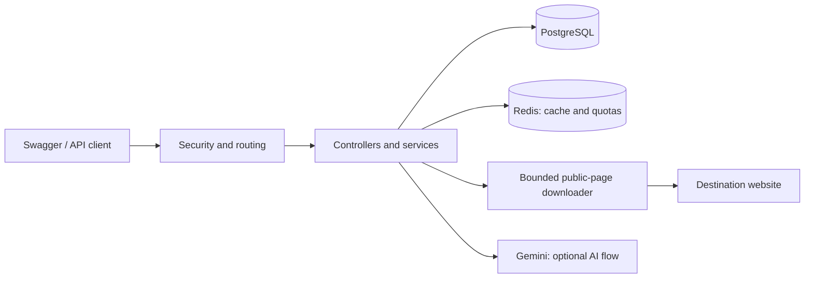

# Linkly interview guide

Read sections 1–7 first. Use the questions and expandable reference sections when you need more detail. For setup, start with the [README](../README.md); for payloads, use the [API reference](API_REFERENCE.md).

## 1. Explain the project in one minute

> Linkly is a Spring Boot REST API that turns long URLs into shareable short links. Users register and log in with JWT authentication, create links, and view their own saved mappings and click counts. Anyone can open a saved short link and receive an HTTP redirect.
>
> There are two creation flows. Basic shortening generates a random code and works without AI. The optional Gemini flow suggests readable slugs and assesses downloaded destination content before saving. PostgreSQL stores users and mappings. Redis speeds up destination reads and enforces per-user creation quotas.
>
> The main engineering decisions are keeping basic shortening independent of AI, preventing duplicate mapping rows during slug collisions, counting redirects even on cache hits, and controlling what the server can download for AI assessment.

This is a backend interview demo with Swagger UI. Describe the implemented behavior and tests; avoid claiming production-scale traffic or guaranteed malicious-link detection.

## 2. Architecture and data



The downloader and Gemini are used by AI confirmation. Basic shortening never downloads the destination or calls Gemini.

| Component | Responsibility |
|---|---|
| Java 21 / Spring Boot 3.5.11 | HTTP API, dependency injection, application lifecycle |
| Spring Security + JWT | Stateless authentication and protected routes |
| JPA / Hibernate + PostgreSQL 16 | Durable users, mappings, and atomic click updates |
| Redis 7 | Destination cache and atomic request quotas |
| Gemini `gemini-2.5-flash-lite` | Slug suggestions, content safety decision, tags/category |
| Apache HttpClient + Jsoup | Controlled downloads and preparation of page excerpts |
| Docker Compose | Reproducible local app, database, and Redis setup |

**Data model:** one user owns many URL mappings. A user stores an ID, unique email, and BCrypt password hash. A mapping stores its ID, owner, original URL, unique short code, creation/optional expiry timestamps, click count, tags, and category. PostgreSQL's unique constraints are the final authority for email and short-code uniqueness.

Code is organized into `controller` (HTTP), `service` (workflows), `repository` (database access), `entity` (stored data), `dto` (request/response/cache shapes), `config` (security/cache), `safety` (download/context preparation), `validation`, and `util`.

The repository keeps its main entry points at the root and supporting material in folders:

```text
url-shortener/
  README.md                    Overview and local startup
  start-linkly.cmd              Start the Docker stack and follow app logs
  stop-linkly.cmd               Stop this stack while retaining data
  .env.example                 Credential template; .env stays private
  docker-compose.yml           App, PostgreSQL and Redis services
  dockerfile                   Java image build
  pom.xml, mvnw, mvnw.cmd, .mvn/ Maven build and wrapper
  docs/
    API_REFERENCE.md           Request bodies and runnable workflows
    LINKLY_INTERVIEW_GUIDE.md   Design, interview questions and reference
  scripts/
    start-linkly.ps1, stop-linkly.ps1
    generate-secrets.cmd        Optional manual signing-secret helper
    tests/Test-StartLinkly.ps1   Isolated Windows helper tests
  src/main/                    Java code and application configuration
  src/test/                    Java tests and isolated test settings
```

Commands in this guide assume the project root as the current directory. `target/` contains generated build/test output and is ignored by Git.

## 3. The four flows to understand

### Authentication and ownership

Registration validates input, hashes the password with BCrypt, stores the user, and returns a JWT. Login verifies the stored hash and returns a JWT. Protected requests send `Authorization: Bearer <token>`.

The JWT subject is the email and its default lifetime is 24 hours. The authentication filter verifies the token and looks up the user. Services derive the owner from the authenticated identity rather than accepting a user ID in the request. `GET /api/urls` returns only that user's mappings, newest first, including full original URLs, short URLs, and metadata.

### Basic shortening

1. Authenticate and validate `{ "originalUrl": "https://example.com" }`.
2. Check the user's Redis quota.
3. Generate a random 10-character Base62 code using `SecureRandom`.
4. Save one mapping owned by the user and return `201 Created` with its short URL.

Validation checks HTTP(S) URL syntax, a host, valid ports, and absence of embedded credentials/whitespace. **It does not fetch the destination or provide a spam/safety verdict.** Even an unreachable site or private URL can be shortened if its syntax is valid. Tags are empty and category is `Uncategorized`.

### AI shortening

1. **Suggest:** Gemini proposes a readable slug from the URL. The server returns the slug, preview URL, and an HMAC verification token. Nothing is saved yet.
2. **Regenerate, optional:** send the exact URL, previous slug, and its token. A different slug and new token are returned.
3. **Confirm:** send the URL, selected slug, and matching token. The server verifies the signature, downloads permitted destination content, and asks Gemini whether it is safe. Only an accepted safety result permits creation. Tags/category are requested next, then one mapping is saved.

Required fetch/AI failures prevent saving. Optional tagging failures fall back to empty tags and `Uncategorized`. A suggestion reserves no code and creates no mapping. Its preview may already resolve to someone else's existing mapping if that code is taken. Use the final confirmed `shortUrl`, which can change during collision handling.

### Redirect and count

1. A public `GET /api/urls/{shortCode}` looks up destination metadata through `UrlLookupService`.
2. Redis can supply the mapping ID, original URL, and expiry; otherwise PostgreSQL supplies them.
3. The service checks validity and runs an atomic database increment that also checks the current expiry.
4. It returns `302 Found` with a `Location` header containing the original URL.

Only the lookup is cached. The redirect service itself is not cached, so every successful request still increments the counter. An atomic SQL increment avoids lost updates from simultaneous requests. Expired links return `410`; missing/deleted links return `404`. A failed update evicts cached metadata and rechecks the database.

The count measures redirect requests, including repeat visits and bots. It does not prove a person followed the destination. PostgreSQL is still needed on cache hits because every counted redirect writes to it.

## 4. Key design decisions

### Random codes and collisions

Base62 uses letters and digits. Ten random characters give `62^10` possible initial codes, but randomness alone cannot guarantee uniqueness. The database enforces a unique short code.

`UrlMappingCreationService` reserves one row using a temporary code to obtain its ID, then updates that same row to the requested code. If the requested code exists, it adds a Base62 representation of the ID as a suffix. It leaves room within the 100-character column limit. A real unique-constraint race rolls back and retries in a fresh transaction, up to three attempts.

The important property is **one committed row per successful creation**. AI/network work happens before this short creation transaction. Confirmation is not idempotent: repeating a valid request can create another suffixed mapping.

### Two signing secrets

`JWT_SECRET` signs authentication tokens. `VERIFICATION_SECRET` signs the exact URL/slug pair using HMAC-SHA256. They have separate purposes and should be independent.

The verification token lets the server check that a submitted URL and slug match a server-issued suggestion without storing preview state. Comparison is constant-time. It does not encrypt anything, expire, bind to a user, or prevent replay. The JWT authenticates the caller separately.

JWT payloads are readable without a secret. A leaked signing secret enables **forgery**, rather than being needed to decode the payload. Changing secrets invalidates existing JWTs or outstanding suggestion proofs.

### Redis serves two different purposes

| Use | Behavior when Redis fails | Reason |
|---|---|---|
| Destination cache | Log the cache failure and use PostgreSQL | Cached reads are an optimization |
| Creation/AI rate limiting | Return `503` before doing the work | Avoid bypassing quotas when their enforcement is unavailable |

Destination metadata is cached for one hour under `urlDestinations`. A dedicated DTO and configured JSON mapper support expiry timestamps. Keeping lookup in a separate Spring bean ensures calls pass through Spring's caching proxy.

Rate limiting uses a Redis Lua script to increment a counter and set/repair its TTL atomically. Separate per-user windows start with the first attempt and last one hour:

| Operation | Attempts per hour |
|---|---:|
| Basic shorten | 30 |
| Suggest | 10 |
| Regenerate | 5 |
| Confirm | 10 |

Attempts reaching the limiter consume quota even if later verification or provider calls fail. Exhaustion returns `429`. These are fixed windows, not a sliding-window algorithm. Login and registration currently have no IP-based rate limit.

## 5. How content assessment works

**Gemini makes the content safety/spam decision. Java downloads and prepares the evidence.** There is no handwritten keyword or page-pattern spam classifier.

For AI confirmation, `PageContentFetcher` downloads HTML or plain text. `PageContentService` uses Jsoup to extract visible text plus bounded form, redirect-related markup, and script excerpts. The AI context includes the final URL and is capped at 12,000 characters: up to 7,000 visible text, 2,500 form/redirect markup, 1,000 script excerpt, and 1,000 final URL characters within that total.

No JavaScript runs. Images, frames, linked scripts, and other subresources are not downloaded. This is a bounded page snapshot, rather than a browser rendering or whole-site crawl.

### Why the downloader has restrictions

A server fetching a caller's URL could otherwise be tricked into contacting its own localhost or private network. That is server-side request forgery (SSRF). The downloader:

- Allows public HTTP port 80 or HTTPS port 443 with normal TLS verification.
- Checks all resolved IP addresses, rejects local/private/special addresses, and pins validated addresses to the actual connection.
- Revalidates every HTTP redirect and forwards no caller cookies or authorization headers.
- Limits responses to 1 MiB after decompression, three redirects, two-second connection/read timeouts, and an eight-second total deadline by default.
- Allows four concurrent downloads with no waiting queue.

These are protections for the fetching server. They do not label webpage content as spam and do not run for basic shortening, where the server never fetches the destination.

### How AI failures are handled

Only a complete `SAFE` answer is accepted, ignoring case and outer whitespace. Substrings such as `NOT SAFE` or `SAFETY` do not pass. Provider responses and generated slugs/metadata are validated and bounded. Gemini requests have a five-second connection timeout and a default 15-second request deadline; missing keys and provider errors produce controlled errors.

Page text is treated as untrusted prompt input, but prompt instructions do not guarantee immunity to prompt injection. Gemini can make mistakes. Hidden/browser-generated content, material outside excerpts, and later page changes are outside this check. Basic responses have no safety verdict; AI approval describes the fetched context at creation time.

## 6. Failure behavior you should be able to explain

| Situation | Result |
|---|---|
| Gemini key missing or provider unavailable | App starts; basic/auth/list/redirect still work. Required AI calls return `503` |
| PostgreSQL unavailable | Storage, login/ownership lookup, and reliable redirects cannot work |
| Redis unavailable | Redirect lookup falls back to DB; quota-protected creation/AI routes return `503` |
| Invalid JSON/URL, invalid suggestion proof, rejected AI verdict, blocked fetch target | `400` |
| Missing/invalid JWT, including a deleted user | JSON `401` |
| Duplicate registration email | `409` |
| Expired / missing mapping | `410` / `404` |
| Unsupported, empty, oversized, unsuccessful, or otherwise unreadable AI destination | `422` |
| Fetch/TLS failure, timeout, saturated downloader, required AI failure | `503` |
| Quota exhausted | `429` with no response body |
| Unexpected application failure | Generic `500` |

Fetch-specific errors apply to AI confirmation. Basic shortening does not depend on destination reachability.

## 7. A five-minute interview demo

1. Run `start-linkly.cmd` and open Swagger after the health check succeeds.
2. Register a demo account, authorize with its JWT, and create a basic link.
3. Open the short URL twice and list your links. Show the full original URL and increasing count.
4. Log in as a second user and show that their list excludes the first user's links.
5. If a working Gemini key is available, suggest a readable slug and confirm it. Explain why the preview was not saved yet.

The Windows helper generates three independent 48-byte random credentials and writes them to a Git-ignored `.env`. It preserves existing configured values, handles paths with spaces, waits for Docker and application readiness, and returns a failure exit code if setup fails. Both CMD files use PowerShell helpers under `scripts/`.

Startup follows live app logs until the app stops. Closing the log window leaves the containers running. Use `stop-linkly.cmd` in another window to stop the app first, then PostgreSQL and Redis. Use `--no-pause` for one-shot startup or unattended shutdown.

Shutdown uses Compose project/service labels, preserves containers, volumes and `.env`, and leaves Docker Desktop and unrelated projects running. It works even when credentials are missing because shutdown does not interpolate the Compose configuration. Startup releases its setup lock before following logs so shutdown is not blocked.

Docker initializes the database password on the first run and stores database data in a named volume. Generating a different password later does not change that stored password. If the old database exists but `.env` has no password, the helper stops so you can restore it. Normal restarts preserve both credentials and data.

## 8. Likely follow-up questions

**Why PostgreSQL instead of storing mappings only in Redis?** PostgreSQL provides durable data, relationships, uniqueness constraints, and transactional updates. Redis accelerates reads and coordinates quotas; losing cached destinations does not lose links.

**Why use 302 instead of 301?** A temporary redirect reduces permanent browser caching of the destination and better supports server-side request counting. The counter still measures requests reaching the service, not unique visitors.

**Does caching remove all database work?** No. It can avoid a destination read, but every successful redirect performs an atomic write. That is a deliberate correctness choice for the demo. At large scale, I would evaluate event-based analytics with explicit delivery and deduplication semantics.

**What happens if two users choose the same slug?** Codes are globally unique because the public redirect contains no user ID. A collision receives an ID-based suffix. The unique constraint handles races; separate transaction retries recover from actual conflicts.

**Can a user modify the suggested slug?** Changing the URL or slug invalidates its HMAC proof. The basic endpoint independently permits random-code creation. Signed suggestions are not an access-control boundary for existing links.

**What happens when Gemini is down?** Basic creation works without calling Gemini. Required AI steps return `503` and do not save a mapping. A tagging failure alone uses fallback metadata after successful assessment.

**Why does setup detect an old database after containers and images are deleted?** Docker volumes have their own lifecycle. The PostgreSQL volume can still contain the database files. Setup recognizes the Compose project's PostgreSQL container or named volume by labels; it does not query tables to prove that records exist.

**Is a basic short link safe?** No safety claim is made. Basic mode validates URL structure only. AI mode assesses selected page content, which also cannot guarantee safety.

**Can someone steal a JWT by reading it?** JWTs are bearer credentials: possession allows use until invalid/expired. Their payload is readable, while the signature prevents undetected modification without the signing key. Do not log or publish them.

**What was a significant bug you fixed?** Previously caching the entire redirect method could skip click increments on cache hits. The fix caches only metadata and leaves the atomic increment on the path for every redirect. Another creation fix updates one reserved row during slug collisions rather than saving duplicate mappings.

**What would you improve next?** Pagination and link lifecycle management, then idempotent confirmation and expiring/user-bound suggestion proofs. For public deployment, add reviewed schema migrations, auth abuse limits, secret management, and stronger operational monitoring. These are future work, not implemented features.

**How did you test this?** Controller/service tests cover authentication, ownership, collisions, concurrent clicks, expiry, and dependency failures. Local mock HTTP servers test Gemini output handling and controlled page downloads without paid requests. Optional integration tests exercise actual PostgreSQL/Redis behavior. The setup helper has separate Windows tests.

## 9. Practical reference

<details>
<summary><strong>Docker storage, existing databases, and password recovery</strong></summary>

Containers run the services, images provide their software, and volumes hold persistent files. PostgreSQL stores its files in the Compose `postgres-data` volume, normally named `url-shortener_postgres-data` for this project.

| Action | Containers | PostgreSQL data |
|---|---|---|
| `stop-linkly.cmd` | Stopped and retained | Retained |
| `docker compose down` | Removed, along with the project network | Retained |
| Delete only containers/images | Removed items can be recreated | Retained if the volume remains |
| Delete the PostgreSQL volume / `docker compose down -v` | Depends on the command | Permanently deleted |

Setup checks Docker labels for this Compose project and either its `postgres` container (including stopped containers) or its `postgres-data` volume. It treats either as potentially existing data. It does not inspect SQL tables, detect a separately installed Windows database, or search other Compose projects. The project name comes from `COMPOSE_PROJECT_NAME` in the shell or `.env`, otherwise the normalized folder name; renaming the folder can change that identity.

To reuse an existing database:

1. Check the available containers and volumes with `docker ps -a` and `docker volume ls`.
2. Keep the matching `DB_PASSWORD` in `.env`. If the old `linkly-postgres` container still exists, retrieve its configured password locally:

   ```powershell
   docker inspect linkly-postgres --format '{{range .Config.Env}}{{println .}}{{end}}' |
       Select-String '^POSTGRES_PASSWORD='
   ```

   Copy only the value after `POSTGRES_PASSWORD=` into `DB_PASSWORD` in `.env`. The printed value is the configured password, not a masking label. It normally matches the database unless an administrator changed the database password later.
3. Preserve existing JWT/verification secrets when available. Missing or template values are generated on startup. New secrets require logging in again and requesting fresh AI suggestions; they do not remove accounts or links.
4. Run `.\start-linkly.cmd`. It reuses the volume and configured credentials.

If the container was deleted but the volume remains, `docker inspect` cannot recover its former environment. Restore the password from the previous `.env` or a backup. The starter does not recover/reset a database password, and a newly generated password cannot unlock old data.

For an intentionally empty demo database, stop the stack, remove its stopped PostgreSQL container, and delete only its PostgreSQL volume in Docker Desktop. **Deleting that volume permanently removes its users and saved links.** Rerun startup afterward. Keeping `.env` reuses configured credentials; an actually fresh setup generates missing/template credentials. No volume is deleted automatically by either CMD helper.

</details>

<details>
<summary><strong>Run Java locally, with or without Docker services</strong></summary>

Install Java 21. The Maven wrapper downloads Maven; no separate Maven installation is required. Use an installed PostgreSQL instance with database `url_shortener`, and make Redis available.

To run only the dependencies in Docker after configuring `.env`:

```powershell
docker compose up -d postgres redis
docker compose exec redis redis-cli ping
```

Expect `PONG`. In the PowerShell window used to start Java, set:

```powershell
$env:DB_HOST = 'localhost'
$env:DB_PORT = '5433' # Use 5432 for a typical installed PostgreSQL service.
$env:DB_NAME = 'url_shortener'
$env:DB_USERNAME = 'postgres'
$env:DB_PASSWORD = '<the matching database password>'
$env:REDIS_HOST = 'localhost'
$env:REDIS_PORT = '6380' # Use your Redis service's port for a non-Docker setup.
$env:JWT_SECRET = '<your generated JWT signing secret>'
$env:VERIFICATION_SECRET = '<your independent verification signing secret>'
$env:GEMINI_API_KEY = '' # Optional; add a working key for AI routes.
.\mvnw.cmd spring-boot:run
```

For a fully non-Docker run, use installed PostgreSQL and Redis services at their configured addresses. On Windows, Redis may run in an existing supported WSL Linux distribution. Docker Desktop's internal `docker-desktop` distribution is not a general-purpose Linux installation.

Spring Boot does **not** load the root `.env` automatically when Java runs directly. Set environment variables or the IDE's run environment. An ignored local `src/main/resources/application.properties` can override matching tracked YAML settings; remove stale hardcoded values or use environment placeholders.

To run a packaged JAR instead:

```powershell
.\mvnw.cmd clean package
java -jar target/url-shortener-0.0.1-SNAPSHOT.jar
```

The manual helper `scripts/generate-secrets.cmd` remains available for setup without the automatic starter. Run `.\scripts\generate-secrets.cmd` from the project root. It prints only the two signing secrets and does not write `.env` or start services. The root `start-linkly.cmd` performs the complete Docker setup, including the database password.

</details>

<details>
<summary><strong>Configuration and common startup problems</strong></summary>

| Variable | Purpose / default |
|---|---|
| `DB_PASSWORD` | Required; generated by Windows setup for a fresh database |
| `JWT_SECRET`, `VERIFICATION_SECRET` | Required independent signing secrets; use at least 32 bytes each, generated by setup |
| `GEMINI_API_KEY` | Optional, blank by default; required for AI routes |
| `APP_BASE_URL` | Origin used in returned links; `http://localhost:8080` |
| `CONTENT_CHECK_TIMEOUT_SECONDS` | Fetch deadline; 8 seconds, configurable from 1–30 |
| `DB_HOST`, `DB_PORT` | Direct Java defaults: `localhost`, `5432` |
| `DB_NAME`, `DB_USERNAME` | `url_shortener`, `postgres` |
| `REDIS_HOST`, `REDIS_PORT` | Direct Java YAML defaults: `localhost`, `6379` |
| `JWT_EXPIRY` | 86400000 milliseconds (24 hours) |
| `GEMINI_API_URL`, `GEMINI_TIMEOUT_SECONDS` | Provider endpoint and 15-second request deadline |

Compose supplies internal database/Redis hostnames and ports. Host mappings are app `8080`, PostgreSQL `5433`, Redis `6380`. Some advanced settings above apply to direct Java runs; edit Compose deliberately if overriding settings it fixes explicitly.

- **Port conflict/container name already used:** inspect `docker ps -a`; stop the conflicting local app/container if appropriate. For a standalone `linkly-redis`, run `docker stop linkly-redis`, then `docker rename linkly-redis linkly-redis-standalone` (choose an unused name), before starting the full stack. This retains the old container and frees both its name and port for Compose. Stopping alone does not free a container name.
- **Database password error:** restore the password associated with the existing PostgreSQL volume. Editing `.env` alone does not rotate it. Avoid deleting the volume to solve a mismatch.
- **401:** use a fresh login JWT in the Authorization header. The suggestion verification token belongs in the JSON body and is a different token.
- **AI 503:** check that `GEMINI_API_KEY` is set and valid, rerun setup to recreate the app with it, and inspect provider/network errors in `docker compose logs app`.
- **Redis exception during local Java execution:** verify the service is running and use host port `6380` for the Compose Redis instance, rather than its internal port `6379`.

The Docker build excludes `.env` and ignored local application properties. Compose injects secrets at runtime. Do not commit generated credentials. `docker compose down` preserves the database volume; `down -v` deletes it.

</details>

<details>
<summary><strong>Tests and verification commands</strong></summary>

```powershell
.\mvnw.cmd test
powershell.exe -NoProfile -ExecutionPolicy Bypass -File .\scripts\tests\Test-StartLinkly.ps1
```

The ordinary Java suite uses isolated H2 databases, an in-memory cache, and dynamic-port WireMock servers. It needs no real Gemini key. Tests cover basic creation with no AI/fetching, AI-only content decisions, HMAC validation, authentication/ownership, collision recovery, cache-hit/concurrent counting, expiry/deletion, dependency errors, content limits, and DNS/private-address protections.

The setup tests use temporary fixtures and a fake Docker command. They check credential generation/preservation, missing-password protection, duplicate settings, explicit `.env` use, readiness and live-log orchestration, graceful shutdown order, project isolation, repeated stops, failure propagation, and cleanup. They do not modify the project's real `.env` or start Docker.

Optional tests use real dependencies. Use disposable containers only: the PostgreSQL test creates/drops its test schema.

```powershell
docker run -d --name linkly-test-redis -p 127.0.0.1:16379:6379 redis:7-alpine
docker run -d --name linkly-test-postgres -e POSTGRES_PASSWORD=isolated-test-only -e POSTGRES_DB=linkly_audit -p 127.0.0.1:15432:5432 postgres:16-alpine
docker exec linkly-test-postgres pg_isready -U postgres -d linkly_audit
# Run only after PostgreSQL reports ready.
.\mvnw.cmd "-Dlinkly.test.redis.port=16379" "-Dlinkly.test.postgres.port=15432" test
docker rm -f linkly-test-redis linkly-test-postgres
```

These check PostgreSQL atomic redirects and real Redis Lua counters/cache serialization. An optional HTTPS smoke check fetches only `https://example.com`:

```powershell
.\mvnw.cmd "-Dtest=PublicContentSmokeTest" "-Dlinkly.test.public-content=true" test
```

Use a test environment; do not point integration tests at your demo data. Mocked Gemini tests establish handling of specified responses, not real-world model accuracy.

</details>

<details>
<summary><strong>Current scope and future changes</strong></summary>

There is no frontend, pagination, edit/delete/expiry-setting API, refresh token, logout revocation, or database migration tool. Hibernate `ddl-auto=update` is a local development convenience. Timestamps use server-local time, so consistent clocks/timezones matter across instances.

Adding destination editing requires explicit cache invalidation. Adding expiration management should retain both cached and database checks. At larger scale, assess write pressure from counting every redirect before adopting asynchronous analytics. Changing that design requires defining how delayed, lost, or duplicated events affect counts.

Suggested improvement order for this interview demo: pagination and link management; idempotent confirmation and expiring/user-bound proofs; then production-specific deployment controls if the project's scope expands. Keep basic shortening independent of AI throughout.

</details>
